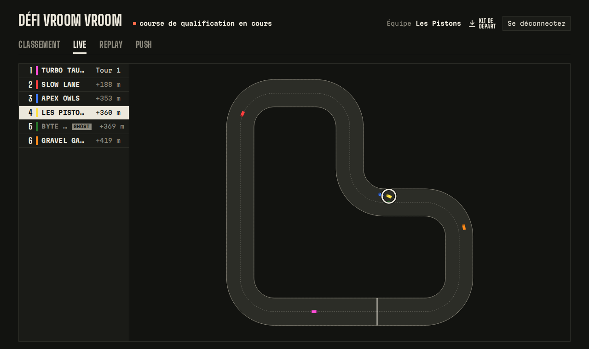
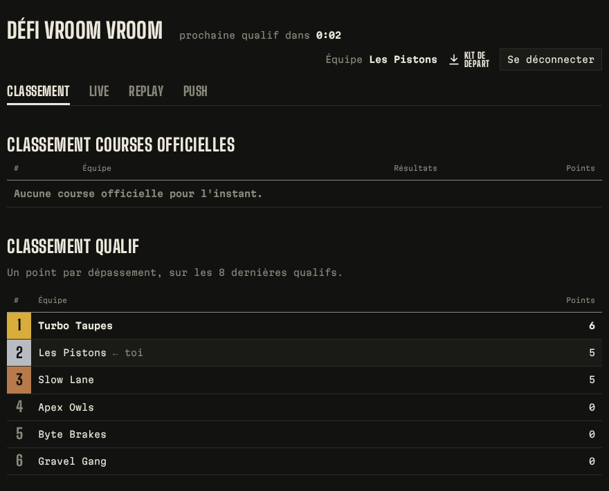

<h1 align="center">cocoracer-server</h1>

<p align="center">
  The event server for a programming-competition car race.
</p>

<p align="center">
  <a href="https://github.com/nicolaslauzon/cocoracer-server/actions/workflows/ci.yml"></a>
  
  
  <a href="LICENSE"></a>
</p>

<p align="center">
  
</p>

Each team pushes a Python controller for a simulated car from a web page. The
server races the teams' controllers against each other every two minutes, runs
each one in its own sandboxed process, and keeps the leaderboards. Everyone
watches the races live in the browser.

| Path | Contents |
| --- | --- |
| `cocoracer/` | Simulator, a git submodule with its own README |
| `server/` | Event server, its tests and `deploy.sh` |
| `start_kit/` | What teams receive |
| `csgames_ulaval_qualification_fall_2026/` | The competition's leaderboards, score progression and the teams' controllers |
| `docs/` | Deployment guide and design decisions in `docs/adr/` |

## Run it locally

The server needs Linux x86_64 with Landlock, Python 3.12, libseccomp
(`apt install libseccomp2`) and [uv](https://docs.astral.sh/uv/).

```bash
git clone --recursive https://github.com/nicolaslauzon/cocoracer-server.git
cd cocoracer-server/server
uv sync --extra dev
.venv/bin/cocoracer-server --host 127.0.0.1 --state-dir state
```

Open <http://127.0.0.1:8080>. Teams sign themselves up and push a controller
from their Push tab. A qualification race runs every 120 s, which
`--interval` changes. The admin signs in with the password in
`COCORACER_ADMIN_PASSWORD`. When that variable is unset, the server prints a
generated password at startup. The admin starts the official races from the
Admin tab. `cocoracer-server --help` lists the options.

<p align="center">
  
</p>

## Deploy

Run `sudo server/deploy.sh` on a dedicated machine. It runs as root,
installs systemd units and reconfigures the ufw firewall. It is the only
supported way to put the server on a network. See
[docs/deploying.md](docs/deploying.md).

## Known limitations

- The server speaks plain HTTP and `/login` has no rate limit, so use it on
  a trusted network.
- The sandbox works on Linux only. On another system no car can race.
- The scoring and schedule rules are constants in `scoring.py` and
  `scheduler.py`.

## Contributing

[AGENTS.md](AGENTS.md) has the checks and conventions.

## License

MIT, see [LICENSE](LICENSE).
