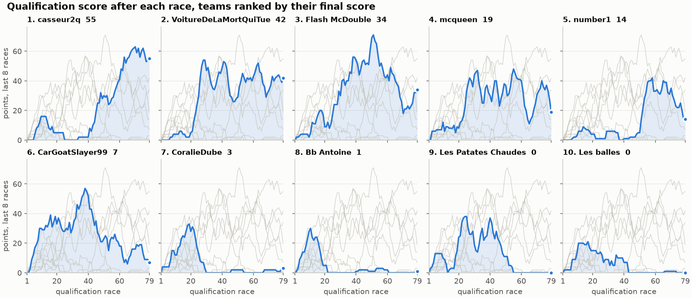
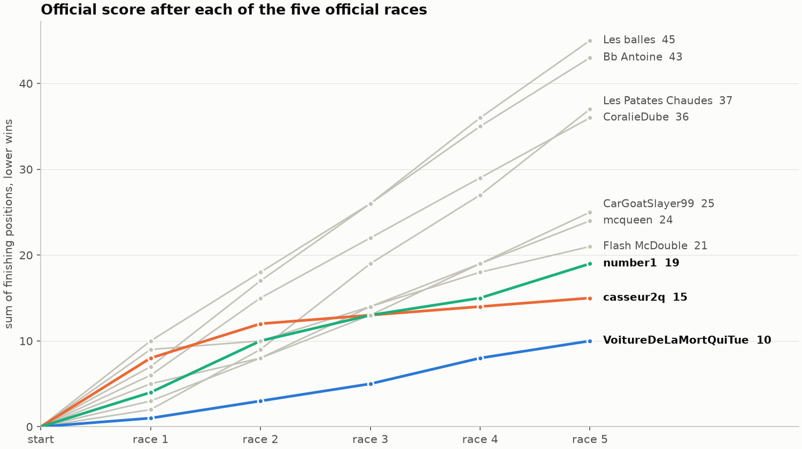

<h1 align="center">CS Games Ulaval qualification, Fall 2026</h1>

<p align="center">
  The leaderboards and score progression of the cocoracer competition,
  recovered from the event server's state.
</p>

<p align="center">
  
  
  
  
</p>

<p align="center">
  
</p>

Ten teams wrote a controller for a simulated car and pushed it to the server
from a web page, 522 times in all. On the evening of 8 October 2026, from
18:53 to 21:40 (Eastern), the server raced all ten against each other: a
qualification race every two minutes, and five official races on top. The
controllers are in [`team_controllers/`](team_controllers/).

## Official leaderboard

The official score is the sum of a team's finishing positions in the five
official races. The lowest score wins.

| Rank | Team | Race 1 | Race 2 | Race 3 | Race 4 | Race 5 | Score |
| ---: | --- | ---: | ---: | ---: | ---: | ---: | ---: |
| 1 | **VoitureDeLaMortQuiTue** | 1 | 2 | 2 | 3 | 2 | **10** |
| 2 | **casseur2q** | 8 | 4 | 1 | 1 | 1 | **15** |
| 3 | **number1** | 4 | 6 | 3 | 2 | 4 | **19** |
| 4 | Flash McDouble | 9 | 1 | 4 | 4 | 3 | 21 |
| 5 | mcqueen | 5 | 3 | 5 | 6 | 5 | 24 |
| 6 | CarGoatSlayer99 | 3 | 5 | 6 | 5 | 6 | 25 |
| 7 | CoralieDube | 6 | 9 | 7 | 7 | 7 | 36 |
| 8 | Les Patates Chaudes | 2 | 7 | 10 | 8 | 10 | 37 |
| 9 | Bb Antoine | 10 | 8 | 8 | 9 | 8 | 43 |
| 10 | Les balles | 7 | 10 | 9 | 10 | 9 | 45 |

<p align="center">
  
</p>

VoitureDeLaMortQuiTue led from the first race and never finished below third.
casseur2q finished eighth in race 1, then won races 3, 4 and 5 and took second
place. Les Patates Chaudes was second in race 1 and tenth in races 3 and 5.

## Qualification leaderboard

The qualification score counts overtakes: one point per pass, a pass taken back
cancelling it, summed over the last eight qualification races. The grid is
shuffled at random for every race, so the score measures how well a controller
overtakes and not where it starts. See
[ADR 0001](../docs/adr/0001-two-tier-scoring.md).

| Rank | Team | Points |
| ---: | --- | ---: |
| 1 | casseur2q | 55 |
| 2 | VoitureDeLaMortQuiTue | 42 |
| 3 | Flash McDouble | 34 |
| 4 | mcqueen | 19 |
| 5 | number1 | 14 |
| 6 | CarGoatSlayer99 | 7 |
| 7 | CoralieDube | 3 |
| 8 | Bb Antoine | 1 |
| 9 | Les Patates Chaudes | 0 |
| 10 | Les balles | 0 |

The lead changed hands 17 times during the evening. Flash McDouble held the
highest score of the event, 71 points after qualification race 51, and ended
third. casseur2q stayed below 20 points for the first 40 races and took the
lead for good at race 63. Les Patates Chaudes, Les balles, Bb Antoine and
CoralieDube each peaked in the first half of the evening and had fallen
back to a few points or none by the end.

## Files

| File | Contents |
| --- | --- |
| `leaderboard_official.csv` | Final official leaderboard, with each team's position in the five races |
| `leaderboard_qualification.csv` | Final qualification leaderboard |
| `qualification_progression.csv` | Each team's qualification score after each of the 79 qualification races |
| `draw_figures.py` | Rebuilds the CSVs and figures from a `state.json` |
| `team_controllers/` | Every version each team pushed, and `index.tsv` |
| `img/` | The two figures above |

The files come from the server's `state.json`, which holds the teams' password
hashes and stays out of the repository. To redraw everything from a copy of it,
run from the repo root:

```bash
uv run --project server --with matplotlib \
    csgames_ulaval_qualification_fall_2026/draw_figures.py path/to/state.json
```

The script scores the races with the server's own
[`scoring.py`](../server/cocoracer_server/scoring.py). It leaves out the void
race, killed by SIGTERM at the end of the evening, and the 29 qualification
races dated 23 November, after the event. Those later races would move the
final qualification scores: counting them gives casseur2q 59, for example,
instead of 55.
